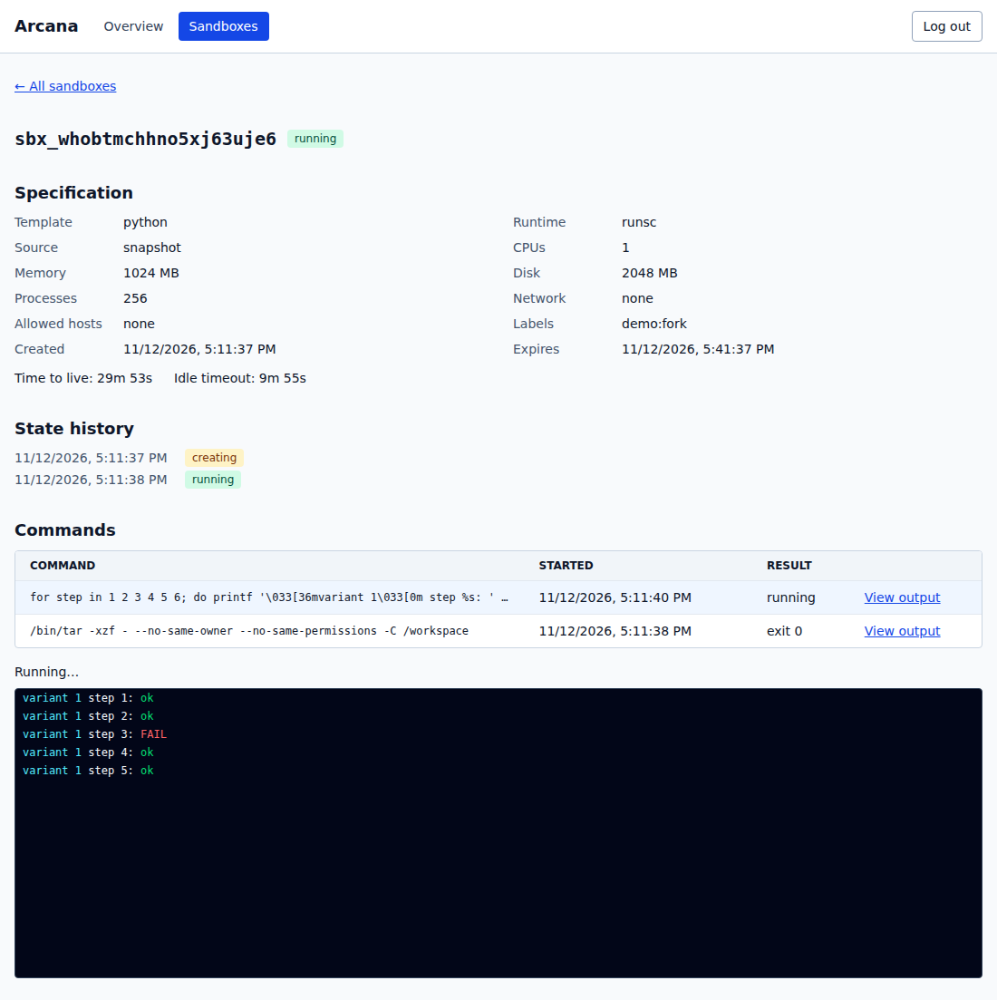

# Arcana

Self-hosted sandboxes for AI agents, written in Go. Arcana turns a Linux Docker
host into an authenticated REST/WebSocket service for ephemeral, isolated work.

v0.3 adds workspace snapshots with restore and fork (try several approaches from
one starting point), an MCP server (`arcana mcp`), Python and TypeScript SDKs, a
read-only web dashboard at `/ui` with live command output, a published
documentation site, a reference coding agent, a benchmark harness and a
development container. v0.2 added isolated allowlist networking through a
per-sandbox egress proxy, warm pools, workspace-ready templates (base, Python,
Node, Go), metadata-only audit events, Prometheus metrics with a Grafana stack,
per-key creation rate limits, and release packaging (archives, deb/rpm, container
image, installer and systemd unit). It builds on v0.1: sandbox lifecycle,
synchronous and streaming exec, binary file and archive transfers, resource
limits, volume or tmpfs workspaces, TTL/idle cleanup, crash reconciliation, API
keys, a Go client, CLI, and host diagnostics. Sandbox networking defaults to
`none`; isolation defaults to gVisor (`runsc`).




*Recorded against a real Arcana on gVisor: the CLI quickstart, and the read-only dashboard following three
parallel variants forked from one snapshot ([recording](docs/images/dashboard.gif)).*

Documentation site sources are in [docs/](docs/) (built with VitePress; see the [architecture](docs/architecture.md)).

## Performance highlights

Measured with `arcana bench` on a small 2 vCPU shared VM (not the PRD reference host), gVisor runsc,
20 samples per scenario ([full results and caveats](docs/benchmarks.md)):

| Metric | PRD target | Measured p50 |
|---|---|---|
| Cold create (image cached) | ≤ 2 s | 206 ms |
| Warm-pool acquire | ≤ 150 ms | 5.6 ms |
| Exec of `true` | ≤ 100 ms | 94 ms (narrow margin) |
| Snapshot of 10 MiB / restore | no target | 569 ms / 811 ms |

The density target (20 idle sandboxes on 8 GB) was **not** tested: the run was capped at 12 on this
host. Treat percentiles above p50 as indicative and repeat on your own hardware.

Self-hosting guides: [install](docs/install.md), [configuration](docs/configuration.md),
[security model](docs/security.md), [networking](docs/networking.md) and
[operations](docs/operations.md).

## Security model

Every sandbox runs as UID 1000 with a read-only root filesystem, all capabilities
dropped, no-new-privileges, bounded resources, and no network access. File operations
and archive extraction execute inside the sandbox. The host never reads Docker
workspace paths, uses `docker cp`, or extracts sandbox archives. Arcana bind-mounts
its exec helper read-only; Docker manages its normal bookkeeping and init mounts.

The helper reaps command descendants. If Arcana cannot prove cleanup, it destroys
the sandbox. Startup reconciliation removes installation-owned orphan resources
and fails closed on commands interrupted by a daemon crash. Healthy sandboxes
are preserved across a normal restart by default. Non-admin keys see only their
own sandboxes; other owners' resources are hidden with 404 responses.

**Docker socket access makes Arcana root-equivalent on the host.** Use a dedicated
host or VM. Keep the API on localhost; remote access needs a TLS-terminating
reverse proxy and protected API keys. `runc` requires an explicit insecure-runtime
opt-in and relies on the shared host kernel. It is not a strong isolation boundary
for hostile code. The dashboard is read-only: browser sessions use a cookie that can only
read (GET/HEAD) and sign out, never create, execute or delete, and the page is served with a
strict Content-Security-Policy; sandbox output is rendered as inert text and kept only in memory.
See the [threat model](docs/PRD.md#12-security-and-threat-model)
and [escape suite](docs/escape-v1.md).

## Quickstart on Ubuntu 24.04

Prerequisites: Linux with cgroups v2, Docker Engine >= 24, Go 1.27.3, Git, curl,
and Python 3. Install [Docker Engine](https://docs.docker.com/engine/install/ubuntu/)
and [Go](https://go.dev/doc/install) using their official instructions, including
verification of the downloaded Go archive. Your operator account must be able to
run `docker info`; membership in the Docker group grants root-equivalent access.
Native Windows/macOS runtime operation is not supported; use a Linux VM or WSL2.

Install gVisor using its [official apt repository](https://gvisor.dev/docs/user_guide/install/):

```bash
sudo apt-get update
sudo apt-get install -y apt-transport-https ca-certificates curl gnupg
curl -fsSL https://gvisor.dev/archive.key | sudo gpg --dearmor --yes -o /usr/share/keyrings/gvisor-archive-keyring.gpg
echo "deb [arch=$(dpkg --print-architecture) signed-by=/usr/share/keyrings/gvisor-archive-keyring.gpg] https://storage.googleapis.com/gvisor/releases release main" | sudo tee /etc/apt/sources.list.d/gvisor.list > /dev/null
sudo apt-get update
sudo apt-get install -y runsc
sudo "$(command -v runsc)" install
sudo systemctl restart docker
```

Get the source, which includes the v0.1 base-image Dockerfile:

```bash
git clone https://github.com/brendatamaar/arcana.git
cd arcana
git checkout v0.1.0
```

Run the following blocks from the repository root in the **same Bash terminal**.
They create a private demo directory and install the binary there. Keep that
directory to reuse its database and keys. If port 7070 is occupied, set
`ARCANA_DEMO_LISTEN=127.0.0.1:7071` first.

<!-- quickstart:install -->
```bash
umask 077
export ARCANA_DEMO_DIR="$(mktemp -d -t arcana-demo.XXXXXXXX)"
mkdir "$ARCANA_DEMO_DIR/bin"
GOBIN="$ARCANA_DEMO_DIR/bin" CGO_ENABLED=0 go install -ldflags="-X main.version=v0.1.0" ./cmd/arcana
export PATH="$ARCANA_DEMO_DIR/bin:$PATH"
export ARCANA_URL="http://${ARCANA_DEMO_LISTEN:-127.0.0.1:7070}"
docker build -t arcana-base:local templates/base
cat > "$ARCANA_DEMO_DIR/config.yaml" <<EOF
data_dir: $ARCANA_DEMO_DIR/data
server:
  listen: ${ARCANA_DEMO_LISTEN:-127.0.0.1:7070}
  destroy_on_shutdown: true
EOF
arcana version
arcana doctor --config "$ARCANA_DEMO_DIR/config.yaml"
```
<!-- /quickstart:install -->

Doctor must have no `fail` results. Missing `/dev/kvm` is informational; this
gVisor setup does not need it. Build the base image before running Doctor:
runtime proof needs an installed configured template. Doctor does not pull images
automatically. See [Doctor validation](docs/doctor-validation.md).
This demo explicitly enables `destroy_on_shutdown` so stopping it removes its
sandboxes. The normal server default preserves healthy sandboxes across restart.

<!-- quickstart:serve -->
```bash
arcana serve --config "$ARCANA_DEMO_DIR/config.yaml" > "$ARCANA_DEMO_DIR/serve.log" 2>&1 &
export ARCANA_DEMO_PID=$!
for attempt in $(seq 1 60); do
  if curl --fail --silent "$ARCANA_URL/v1/health" >/dev/null; then break; fi
  if ! kill -0 "$ARCANA_DEMO_PID" 2>/dev/null; then
    echo "Arcana exited; inspect the private log at $ARCANA_DEMO_DIR/serve.log" >&2
    exit 1
  fi
  sleep 1
done
curl --fail --silent "$ARCANA_URL/v1/health"
```
<!-- /quickstart:serve -->

On first start, Arcana creates an admin key, prints it once to its terminal/log,
and writes `data/admin.key` with mode 0600. Treat the demo log and key file as
secrets. Do not commit them or paste their contents into issue reports.

<!-- quickstart:exec -->
```bash
export ARCANA_API_KEY="$(cat "$ARCANA_DEMO_DIR/data/admin.key")"
sandbox_id="$(arcana --json sandbox create --template base --ttl 120 | python3 -c 'import json,sys; print(json.load(sys.stdin)["id"])')"
arcana exec "$sandbox_id" -- /bin/echo "Hello from Arcana"
printf 'sandbox file\n' > "$ARCANA_DEMO_DIR/input.txt"
arcana files put "$sandbox_id" "$ARCANA_DEMO_DIR/input.txt" /workspace/input.txt
arcana files get "$sandbox_id" /workspace/input.txt "$ARCANA_DEMO_DIR/output.txt"
cmp "$ARCANA_DEMO_DIR/input.txt" "$ARCANA_DEMO_DIR/output.txt"
arcana files ls "$sandbox_id" /workspace
```
<!-- /quickstart:exec -->

You should see `Hello from Arcana`, followed by a listing containing `input.txt`.
The sandbox cannot fetch packages from the internet in v0.1; networking stays off.

<!-- quickstart:cleanup -->
```bash
arcana sandbox rm "$sandbox_id"
unset ARCANA_API_KEY
kill -TERM "$ARCANA_DEMO_PID"
wait "$ARCANA_DEMO_PID"
unset ARCANA_DEMO_PID
printf 'Private demo files retained at %s\n' "$ARCANA_DEMO_DIR"
```
<!-- /quickstart:cleanup -->

After the release tag is published, the module install alternative is:

```bash
go install -ldflags="-X main.version=v0.1.0" github.com/brendatamaar/arcana/cmd/arcana@v0.1.0
```

It still needs a locally built/configured template image and the host prerequisites.
The binary embeds static Linux helpers for amd64 and arm64; it needs no compiler
at serve time. Release archives, packages and the container image include the dashboard.

## CLI and API

Client commands accept `--server`/`--api-key` or `ARCANA_URL`/`ARCANA_API_KEY`.
Prefer the environment or a protected operator session over putting a key in
shell history. `keys` manages the local database and uses `--config`.
Before the cleanup block above, you can try:

```bash
arcana sandbox list --limit 20
arcana --json sandbox get "$sandbox_id"
arcana exec --timeout 10 "$sandbox_id" -- /bin/sh -c 'printf "out\n"; exit 7'
printf 'input\n' | arcana exec --stdin "$sandbox_id" -- /bin/cat
arcana exec --tty "$sandbox_id" -- /bin/sh
arcana files get "$sandbox_id" /workspace/input.txt -
arcana keys create agent --config "$ARCANA_DEMO_DIR/config.yaml"
```

Exec preserves argv after `--` and exits with the remote exit code. TTY requires
a Linux terminal; pipe forwarding is opt-in with `--stdin`. `exec --json` emits
terminal metadata after draining output. `files get` emits raw bytes and rejects
`--json`; named local downloads must not already exist and are created with 0600.
List commands return one page; use `--cursor` to continue.

Snapshots capture a sandbox's `/workspace` (not processes, not files outside it,
not environment values) and can be restored or forked into several sandboxes:

```bash
snapshot_id=$(arcana --json snapshot create "$sandbox_id" | jq -r .id)
arcana fork "$snapshot_id" --count 3
arcana sandbox create --from-snapshot "$snapshot_id"
arcana snapshot list
arcana snapshot rm "$snapshot_id"
```

MCP-capable agents can use Arcana directly through `arcana mcp` (see [MCP server](docs/mcp.md)).

A partial fork prints the sandboxes it created, lists the failures on stderr and
exits non-zero. See [operations](docs/operations.md#snapshots) for limits.

The [OpenAPI contract](api/openapi.yaml) describes `/v1` endpoints. Only
`GET /v1/health` is unauthenticated. For direct HTTP exec:

```bash
curl --fail-with-body "$ARCANA_URL/v1/sandboxes/$sandbox_id/exec" \
  -H "Authorization: Bearer $ARCANA_API_KEY" \
  -H 'Content-Type: application/json' \
  --data '{"cmd":["/bin/echo","hello"],"timeout_seconds":10}'
```

The read-only web dashboard (overview, sandboxes, live command output) is served at `/ui` in release
binaries; see [docs/dashboard.md](docs/dashboard.md).

Measured performance against the PRD targets is in [docs/benchmarks.md](docs/benchmarks.md).

A reference coding agent, [fix-agent](examples/fix-agent), uses sandboxes, snapshots and forks to fix
bugs in ten small [fixtures](examples/fixtures). No real-model results are recorded yet; see
[docs/agent-results.md](docs/agent-results.md).

Python and TypeScript SDKs live in [sdk/python](sdk/python) and [sdk/typescript](sdk/typescript),
generated from the OpenAPI contract with streaming exec, files and snapshot/fork helpers.

The public [Go client](pkg/client) includes typed methods, errors, contexts,
bounded transfer readers, and streaming exec controls with GoDoc examples.
See the [configuration reference](docs/configuration.md) and
[config.example.yaml](deploy/config.example.yaml) for all settings.
Environment overrides use `ARCANA_` and `__`, for example
`ARCANA_SERVER__LISTEN=127.0.0.1:7071`.

## Limits and scope

- The named-volume disk quota is a polling-based soft limit; bursts can exceed it
  before the watchdog runs. Tmpfs provides a hard size limit and consumes RAM.
- Commands in one sandbox share a UID, filesystem and process visibility.
  Detached descendants are reaped when their exec ends; background work must
  stay attached to a command.
- CPU/memory/PID limits reduce noisy-neighbour effects but do not eliminate them.
  Hardware side channels and kernel zero-days beyond gVisor's boundary are outside
  the threat model.
- `runc` shares the host kernel. Never enable its opt-in as a workaround for a
  failed security check on a host that runs hostile workloads.
- Sandboxes are ephemeral. File/archive operations run inside them; failed archive
  extraction can leave partial sandbox files. No output content is stored in SQLite.
- Allowlist egress supports only ports 80/443 without TLS interception, and
  `open` network mode does not exist.
- Snapshots capture the workspace only, not running processes, the container or
  environment values, and a workspace that changes while it is archived can make
  the snapshot fail. The dashboard is read-only until a later release.

## Development and validation

```bash
CGO_ENABLED=0 make build VERSION=v0.3.0
make check
ARCANA_REQUIRE_RUNSC=1 make test-integration test-escape
```

`make check` requires golangci-lint v2.14.0 and a C compiler for the race detector.
Runtime/escape tests need a Linux Docker host with runsc and clean up their
installation-owned resources. They are adversarial tests; use a dedicated VM.
CI validates the same marked quickstart blocks above on a fresh Ubuntu 24.04
runner with the documented prerequisites, then runs the integration/escape suite.

To work in a ready-made environment (Codespaces or Dev Containers), see the
[development container](docs/devcontainer.md).

Read [AGENTS.md](docs/AGENTS.md), [PRD.md](docs/PRD.md), and [PLAN.md](docs/PLAN.md)
before contributing. See the [changelog](CHANGELOG.md) and [architecture decisions](docs/decisions).
Licensed under [Apache-2.0](LICENSE).
