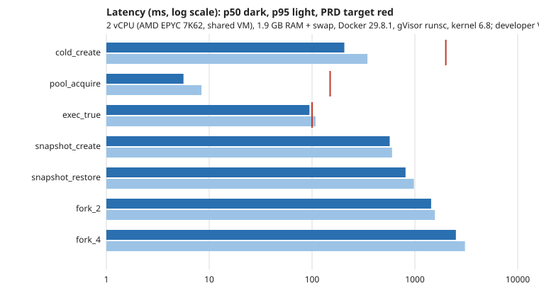

# Benchmarks

`arcana bench` measures a running Arcana through its public API and compares the results with the
targets in PRD §8.2. This page records one run, its host, and what it does and does not show.

## How to run

```sh
arcana bench --scenario all --out bench/results --host-note "<CPU, RAM, storage, runtime>"
python3 scripts/bench_charts.py bench/results/results.json docs/benchmarks/latency.svg
```

It creates real sandboxes labelled `arcana-bench=<run id>` and removes everything it created, so the
server needs free capacity. For meaningful numbers:

- Set `templates[].warm_pool` above 0 for the pool scenario (otherwise it stops with an explanation).
- Raise `limits.create_per_minute_per_key` (the default 30 per minute throttles a benchmark) and
  `limits.max_sandboxes` / `max_sandboxes_per_key`. The density scenario is bounded by those and by `--density-max`.
- Always pass `--host-note`. A latency without its host means nothing.

Scenarios: `cold-create` (labelled requests bypass the pool; one unmeasured warm-up first),
`pool-acquire` (hits only; misses are counted and reported), `exec-overhead` (`/bin/true`), `density`
(idle 256 MB sandboxes until the server refuses or the cap is reached), `snapshot` (snapshot create,
restore into a new sandbox, and forks of 2 and 4). Percentiles are nearest-rank.

## Run of 2026-11-12



Host: a 2 vCPU shared VM (AMD EPYC 7K62), 1.9 GB RAM plus swap, Docker 29.8.1, gVisor runsc, kernel 6.8.
**This is not the PRD reference host** (4 vCPU, 8 GB, SSD), which is larger in CPU and memory, and other
workloads were running on the VM. The benchmark client ran on the same machine, so the numbers include
client CPU contention. Raw data: [results.json](https://github.com/brendatamaar/arcana/blob/main/docs/benchmarks/results.json), [results.md](https://github.com/brendatamaar/arcana/blob/main/docs/benchmarks/results.md).

| Metric | PRD target | Result (p50 / p95 / p99) | Verdict |
|---|---|---|---|
| Cold create (image cached) | p50 ≤ 2 s | 206 ms / 346 ms / 1234 ms | met |
| Pool acquire | p50 ≤ 150 ms, p99 ≤ 500 ms | 5.6 ms / 8.4 ms / 10.4 ms | met |
| Sync exec of `true` | p50 ≤ 100 ms | 94.3 ms / 108.1 ms / 130.9 ms | met, with little margin |
| Idle 256 MB sandboxes | ≥ 20 per 8 GB host | 12 held, **stopped by `--density-max 12`** | not measured |
| Snapshot create (10 MiB) | none | 569 ms / 600 ms / 602 ms | n/a |
| Restore into a new sandbox | none | 811 ms / 978 ms / 979 ms | n/a |
| Fork of 2 / fork of 4 | none | 1.44 s / 2.50 s (p50) | n/a |

### What this shows, and what it does not

- Cold create is about ten times faster than the 2 s target. That agrees with the T0.2 spike, which
  measured runsc create and start at p50 167 ms, and with `docker run --runtime=runsc` on this host taking
  about 250 ms end to end. The p99 of 1.2 s is one slow sample out of 20, not a tail estimate.
- Pool acquire is in single-digit milliseconds because it hands over an already-running instance.
- Exec overhead meets its target only narrowly here. On this shared 2 vCPU VM, with the client competing
  for the same CPUs, that is a fair result but not a robust one; a quieter host is needed before claiming margin.
- **Density was not tested to its target.** The run was capped at 12 because the VM has about 2 GB of RAM
  and other workloads, and exhausting it was not worth the risk. All 12 were created, so the host's real
  limit is above 12, but the 20-sandbox target on an 8 GB host is neither confirmed nor refuted.
- Samples are small (20 per scenario, 5 per fork), a single run, so treat percentiles above p50 as indicative.
- Not measured by this harness: Arcana's idle RSS (target ≤ 80 MB) and the dashboard's JavaScript size
  (target ≤ 200 KB gzip, applicable once the dashboard exists).

Repeat the run on the reference host before publishing performance claims.
