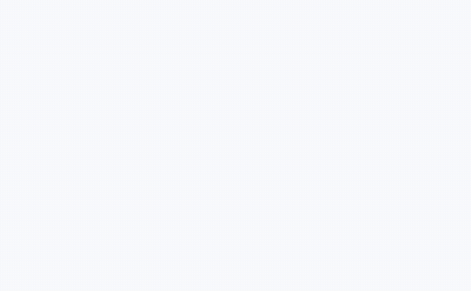

# Web dashboard

Arcana serves a read-only dashboard at `/ui` on the API listener (for example
`http://127.0.0.1:7070/ui/`). Release binaries include it; a binary built with `go install` serves an
explanatory page instead, because the dashboard is built with Node and embedded at release time. Set
`ui.enabled: false` to turn it off.



## Using it

Open `/ui/`, paste an API key and sign in. The key is sent once to `POST /v1/sessions` and exchanged for an
`HttpOnly`, `SameSite=Strict` session cookie; the dashboard never stores the key or a token in the browser.
Pages:

- **Overview**: version, runtime, active sandboxes by template, warm-pool fill (admin keys) and the latest
  terminations with reasons. Admin keys see the whole installation; other keys see their own sandboxes.
- **Sandboxes**: a list filterable by state, template and label, updated live.
- **Sandbox detail**: specification, time-to-live and idle countdowns, state history, command history and a
  live log viewer that follows a running command's output and keeps colours.

It is read-only by design: apart from login and logout it performs no writes, and a session cookie can never
authorize one (see [events and sessions](events.md)). Destroying sandboxes, managing keys and the audit view
are planned for a later release. Everything a sandbox prints, and every name or label, is shown as text.

Behind a reverse proxy that changes the `Host` header, add the public origin to `ui.allowed_origins`.

## Building it

Only building needs Node (LTS) and pnpm (`corepack enable pnpm`); running Arcana never does.

```sh
make web          # build into internal/webui/dist (checks the 200 KB gzip bundle budget)
make build-all    # web, then the arcana binary with the dashboard embedded
make web-dev      # Vite dev server with hot reload; /v1 is proxied to a local Arcana (ARCANA_URL)
make web-generate # regenerate API types from api/openapi.yaml
make web-check    # lint, typecheck, unit tests, generated-types freshness, build and size budget
make web-e2e      # Playwright smoke test against a throwaway Arcana (needs `make build-all` and a browser)
```

The source is in `web/`: React and TypeScript with Vite, TanStack Query for server state, React Router,
Tailwind CSS, and a typed API client generated from the OpenAPI contract. The page is served with a strict
Content-Security-Policy (no inline script or style, no third-party origins), and the code never uses
`innerHTML` or `dangerouslySetInnerHTML` (enforced by lint).
