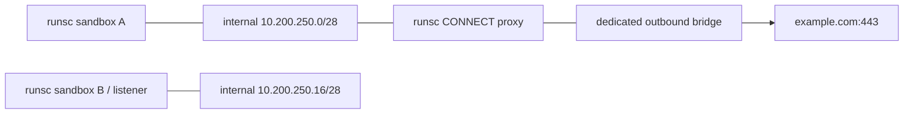

# Allowlist topology under runsc

Task: T0.5. Measured 2026-11-01 on the same VPS as T0.2. The host routes and
existing Docker networks were inspected before selecting two unused /28s.

All containers retain UID 1000, dropped capabilities, no-new-privileges,
read-only rootfs, bounded tmpfs, 256 MiB RAM without swap, 0.5 CPU and 64 PIDs.
No host ports are published. Only the proxy has the outbound network. Networks
and containers are removed by exact ID/name after the test; other VPS services
and networks remain unchanged.

`go test -race -v -tags=integration -run TestNetwork ./test/integration` passed.

| Attempt from sandbox A | Result |
|---|---|
| CONNECT example.com:443 via proxy | 200; upstream TCP connected |
| CONNECT example.org:443 via proxy | 403 |
| CONNECT 169.254.169.254:80 via proxy | 403 |
| Direct TCP 1.1.1.1:443 | network unreachable |
| Direct TCP 169.254.169.254:80 | network unreachable |
| Direct TCP sandbox B:8080 | network unreachable |
| Sandbox B self-check to its active listener | connected, before and after attacks |
| Sandbox A self-check and Docker daemon health | healthy |
| getent ahostsv4 example.com on internal network | exit 2, no addresses |

## API/runtime quirks and chosen mechanism

1. Connecting the proxy's internal network after a runsc container started
   left the listener reachable only through loopback, not its added interface.
   Creating the container, attaching both networks, then starting it worked.
   Build the complete interface set before start. Recreate a runsc proxy when
   its interface set must change; production reconciliation must retain all
   required networks during that operation.
2. Docker's embedded DNS at 127.0.0.11 returned connection refused under runsc
   on these user-defined bridges, including on the dual-homed proxy. This is
   also documented in the [gVisor FAQ](https://gvisor.dev/docs/user_guide/faq/).
   The proxy uses an explicit upstream resolver reachable over its outbound
   bridge (1.1.1.1:53 for this experiment). Sandboxes do not receive a DNS
   egress route. Production should expose operator-configured proxy upstreams.
3. The proxy checks the exact allowed hostname and port, resolves it, rejects
   non-public/private addresses, and dials the checked IP without resolving
   again. The probe validates CONNECT establishment, not a TLS HTTP response;
   there is no TLS interception.
4. The prototype is test scaffolding, not the T2.4 production proxy. Full
   IPv4/IPv6 reserved-range coverage, per-owner policy, audit and concurrency
   management still belong to T2.4/T2.8. These smoke tests do not claim the
   complete ESC-15…19 suite is implemented.

Keep the per-sandbox internal-network design and explicit subnet allocator.
The observations refine DNS and interface setup, without changing the default
network mode none, default sandbox runtime runsc, or any security requirement.
